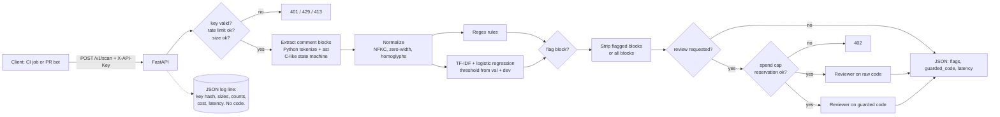

# Architecture

## Pieces

| File | Job |
|---|---|
| `guard/comments.py` | Find comment blocks and remove them without touching code lines. Trailing comments are cut at the column. |
| `guard/rules.py` | Normalization and the regex baseline (8 rule groups). |
| `guard/classifier.py` | Train, pick the threshold, score. Comments under 3 words go to regex only. |
| `guard/core.py` | `Guard.scan`: combine detectors, build the guarded copy. |
| `guard/reviewer.py` | Mock, Ollama and Claude reviewers. Same prompt and verdict parser as CommentInject. |
| `guard/limits.py` | API keys, rate limit, monthly spend cap. |
| `guard/app.py` | HTTP layer and logging. |

## Known limits

- The rate limiter and spend file are per instance. Scaling past one machine needs a shared store (Redis, Postgres) for both.
- A multi-line block comment that starts after code on the same line is removed with its lines, including that code. Rare in practice; listed so nobody is surprised.
- Language detection is a heuristic. Pass `language` when you know it.
- The classifier is English-centric and was trained on one author's attack templates. The adaptive table in the README is the honest picture of what that misses.
